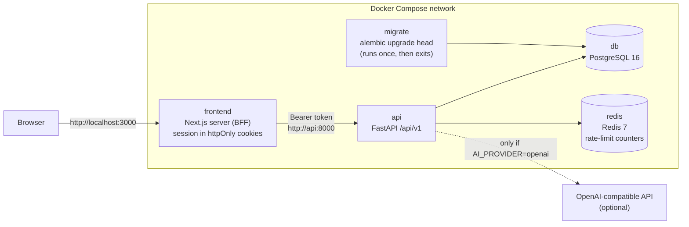

# BudgetAnalytics

A personal finance assistant for people in Kazakhstan: track income and expenses, plan budgets and savings goals, compare deposits, and get plain-language explanations of your finances. All amounts and dates are computed on the server, and the default currency is KZT (₸).

> **Status:** early release candidate (version `0.1.0`), intended for local use and a closed pilot. The [Roadmap and limitations](#14-roadmap-and-limitations) section lists what is not finished yet.

## Table of contents

1. [Project overview](#1-project-overview)
2. [Features](#2-features)
3. [Technology stack](#3-technology-stack)
4. [Architecture](#4-architecture)
5. [Project structure](#5-project-structure)
6. [Prerequisites](#6-prerequisites)
7. [Quick start with Docker](#7-quick-start-with-docker)
8. [Environment variables](#8-environment-variables)
9. [Development without Docker](#9-development-without-docker)
10. [Testing and code quality](#10-testing-and-code-quality)
11. [API documentation](#11-api-documentation)
12. [Security](#12-security)
13. [Database management](#13-database-management)
14. [Roadmap and limitations](#14-roadmap-and-limitations)
15. [Contributing](#15-contributing)
16. [License](#16-license)

---

## 1. Project overview

**What it is.** A web application (Next.js frontend and FastAPI backend) where a user records their accounts and transactions, or imports bank statements. In return they get:

- monthly cash flow, a savings rate and a category breakdown;
- budget utilization and progress toward savings goals;
- deposit income estimates;
- a rule-based financial report.

**The problem it solves.** Bank apps show transactions but rarely answer practical questions:

- "Where does my money go each month?"
- "Am I about to exceed my food budget?"
- "How much will this deposit really earn?"

BudgetAnalytics answers them with deterministic calculations. Money is always handled as exact decimals, never floating point.

**Who it is for.** Individuals in Kazakhstan who manage their money in KZT; other currencies are supported per account. The interface is in Russian.

**Principles.**

- The product is not a bank, lender or broker, and it does not promise returns or approvals.
- Financial numbers always come from the backend's calculations.
- The optional AI layer only explains those numbers and is never the source of them.

**Short description (for GitHub):**
*Personal finance assistant for Kazakhstan: budgets, cash-flow analytics, savings goals, deposit calculator and statement import. Next.js + FastAPI + PostgreSQL.*

## 2. Features

Everything in this section is implemented and covered by automated tests, unless it is marked otherwise.

### Authentication and user accounts
- Registration, login and logout, plus logout from all devices.
- Change password; this ends every session.
- Short-lived access token plus refresh token. Refresh tokens rotate on every use, and reusing an old one revokes the whole session family.
- The user profile includes a default currency (`KZT` unless set otherwise).
- Rate limits on registration, login and token refresh.
- **Not implemented:** password recovery by e-mail. The screen exists, but its button is disabled and labelled as requiring backend support.

### Accounts
- Accounts store metadata only: name, type, currency, optional bank, opening balance and its date, and an archived flag.
- Account types: `cash`, `current`, `card`, `savings`, `credit_card`, `other`.
- Only the last 4 digits of a card may be stored; full card numbers are never accepted.
- The balance is calculated by the backend from the opening balance and the transactions.

### Transactions
- Types: `income`, `expense`, `refund`, `transfer_in`, `transfer_out`.
- Create, edit and delete transactions; filter by period, type, category, account and bank; search the description; paginate.
- Refunds reduce expenses and are not counted as income. Transfers between your own accounts are excluded from income and expenses.

### Categories
- Separate income and expense categories (or both), with a set of default system categories and your own custom ones.
- The backend rejects a category whose kind does not match the transaction type.

### Dashboard and analytics
- Dashboard: current-month income, expenses, savings rate, cash-flow chart, expense breakdown by category, budgets of the month, key indicators and recent operations.
- Analytics endpoints: summary, income, expenses, category breakdown, monthly series, period comparison, savings rate.
- Periods are evaluated in the user's time zone (default `Asia/Almaty`), so month and day boundaries are correct for local time.
- Cash flow is labelled as cash flow, not as an account balance.

### Budgets
- A monthly limit per category.
- Utilization comes from real transactions: `GET /api/v1/budgets/utilization` returns every budget in one call, for any month and time zone.
- The UI shows a warning at 80 % and an "exceeded" state.

### Savings goals
- A target amount and the amount already saved. The backend calculates progress, the remaining amount and the required monthly saving.

### Deposits
- **Deposit calculator.** It supports these capitalization modes: none, monthly, quarterly and annual.
- The backend states its calculation assumptions: nominal rate, ACT/365 day count, and simple interest for an incomplete final period.
- **Saved deposits** have a bank, nominal rate and optional effective rate (ГЭСВ, kept as a separate field).
- The overview shows total deposits and the expected income.

### Statement import
- Upload `.csv` or `.xlsx` bank statements (PDF is rejected). The default limits are 5 MB and 5,000 rows.
- The flow is preview → review rows → commit, so nothing is saved before you confirm.
- Repeated imports are de-duplicated by row fingerprint, and possible duplicates of manually entered transactions are flagged.
- Card-number-like sequences in imported descriptions are masked. There is an import history.
- **Limitation:** the Kaspi, Halyk and Freedom column profiles are **unverified assumptions**, because no real anonymized statements were available. The API reports `verified: false` and the UI shows a warning.

### AI advisor and financial report
- `POST /api/v1/advisor/ask` (a question) and `POST /api/v1/advisor/insights` (a structured report with observations, recommendations, risks, assumptions and missing data).
- The advisor works from facts calculated by the backend; every answer shows its source and data freshness.
- Answers and reports are not stored.
- **Providers:**
  - `AI_PROVIDER=none` (the default) gives deterministic rule-based answers, with no external calls.
  - `AI_PROVIDER=openai` calls an OpenAI-compatible Chat Completions API through a provider adapter, with timeouts, retries and per-user token and cost limits.
  - The `openai` mode has not been tested against a live provider in this repository.

### Other
- Light and dark themes; the layout adapts to phones, tablets and desktop.
- A design-system page at `/design-system` (requires login).
- **Not implemented:** notifications. The screen exists but is labelled as requiring backend support.

## 3. Technology stack

Versions are the ones pinned in the lock files (`frontend/pnpm-lock.yaml`, `backend/requirements*.txt`) or in the Docker images.

| Area | Technology | Purpose | Version |
|---|---|---|---|
| Frontend | Next.js (App Router) | UI, server-side session handling (BFF), API proxy | 16.4.6 |
| | React | UI library | 19.3.1 |
| | TypeScript | Typed frontend code | 5.9.3 |
| UI and styling | Tailwind CSS | Styling and design tokens | 4.3.5 |
| | shadcn styles, tw-animate-css | Base component styles and animations | 4.23.0 / — |
| | lucide-react | Icons | 1.75.0 |
| | Recharts | Charts | 3.11.0 |
| | next-themes | Light and dark theme | 0.4.6 |
| | sonner | Toast notifications | 2.0.8 |
| Data fetching | SWR | Client-side fetching and caching | 2.5.1 |
| Backend | Python | Runtime | 3.12 |
| | FastAPI | REST API (`/api/v1`, OpenAPI) | 0.163.2 |
| | Uvicorn | ASGI server | 0.54.0 |
| | Pydantic, pydantic-settings | Validation, settings from environment | 2.14.3 / 2.16.3 |
| Database | PostgreSQL | Main data store | 16 (`postgres:16-alpine`) |
| ORM and migrations | SQLAlchemy (async), asyncpg | Typed ORM, async driver | 2.1.9 / 0.32.0 |
| | Alembic | Schema migrations | 1.20.1 |
| Auth and security | PyJWT | Access and refresh tokens (HS256 by default) | 2.15.1 |
| | pwdlib (Argon2, bcrypt) | Password hashing | 0.4.2 |
| Cache / Redis | Redis, redis-py | Shared rate-limit counters | 7 (`redis:7-alpine`) / 8.1.0 |
| Other backend | httpx | HTTP client for the LLM provider | 0.28.1 |
| | openpyxl, defusedxml | Reading `.xlsx` statements safely | 3.1.5 / 0.7.1 |
| Testing | pytest, pytest-asyncio | Backend unit, integration and migration tests | 9.2.0 / 1.5.0 |
| | Vitest, Testing Library, jsdom | Frontend unit and component tests | 5.1.1 / 16.3.3 / 31.0.1 |
| | Playwright | End-to-end tests against the real backend | 1.65.1 |
| Code quality | Ruff, mypy, pip-audit | Python lint and format, types, dependency audit | 0.17.5 / 2.4.1 / 2.10.1 |
| | ESLint, Prettier | Frontend lint and format | 10.15.0 / 3.10.1 |
| Infrastructure | Docker, Docker Compose v2 | Local stack, images | — |
| | GitHub Actions | Backend CI | — |
| Package managers | pnpm, pip | Frontend and backend dependencies | 12.21.0 / — |

## 4. Architecture



| Service | Responsibility |
|---|---|
| `frontend` | Renders the UI and acts as a **backend-for-frontend (BFF)**. Login, registration and logout go to `/api/session/*`, which stores the tokens in httpOnly cookies. Every other call goes to `/api/v1/*` on the same origin; the Next.js server adds the access token and forwards it to the API. Browser JavaScript never sees tokens. If the API answers 401, the server refreshes the token once and retries. A route guard (`frontend/proxy.ts`) sends unauthenticated visitors to `/login`. |
| `api` | Business logic and all financial calculations (exact decimals), user-scoped data access, validation, rate limiting and the AI advisor. |
| `migrate` | Runs `alembic upgrade head` on every start, before the API starts. |
| `db` | PostgreSQL with a persistent volume. |
| `redis` | Rate-limit counters shared by all API workers. Nothing is persisted. |

**Request flow:** browser → `frontend:3000` (`/api/v1/...`) → `api:8000` (`/api/v1/...`) → PostgreSQL. The browser never calls the API directly, so CORS is not needed in this setup.

**Startup order (enforced by health checks):** `db` healthy → `migrate` exits successfully → `redis` healthy → `api` healthy (`/health/ready` checks the database and Redis) → `frontend` starts.

**Production layout.** Production uses a separate file, [`backend/docker-compose.prod.yml`](backend/docker-compose.prod.yml), with secrets as files and read-only containers; see [docs/DEPLOYMENT.md](docs/DEPLOYMENT.md). It covers the API, PostgreSQL and Redis; the frontend is not part of it yet.

## 5. Project structure

```text
BudgetAnalytics/
├── compose.yaml               # Full local stack: frontend, api, migrate, db, redis
├── compose.dev-ports.yaml     # Optional: publish PostgreSQL/Redis on 127.0.0.1
├── .env.example               # Settings for compose.yaml (copy to .env)
├── backend/
│   ├── app/
│   │   ├── api/               # FastAPI routers (HTTP layer only)
│   │   ├── core/              # Settings, security, errors, rate limiting, logging
│   │   ├── models/            # SQLAlchemy models
│   │   ├── schemas/           # Pydantic request/response models
│   │   ├── repositories/      # Data access
│   │   ├── services/          # Business logic: finance engine, analytics, imports, AI
│   │   └── integrations/llm/  # LLM provider adapter (OpenAI-compatible)
│   ├── alembic/versions/      # Database migrations
│   ├── tests/                 # unit/, integration/, migrations/
│   ├── scripts/               # backup.sh, restore.sh
│   ├── Dockerfile             # API image (also used by the migrate service)
│   ├── docker-compose.yml     # Backend-only dev stack (PostgreSQL + API)
│   ├── docker-compose.prod.yml
│   ├── pyproject.toml         # Direct dependencies, tool settings
│   ├── requirements.txt       # Hash-pinned runtime lock
│   ├── requirements-dev.txt   # Hash-pinned dev lock
│   └── .env.example           # Settings for running the backend on the host
├── frontend/
│   ├── app/                   # Next.js routes (pages) and route handlers
│   │   └── api/               # BFF: session/[action] and the v1/[...path] proxy
│   ├── components/            # Screens and UI components
│   ├── lib/                   # API client, SWR hooks, errors, formatting, time zones
│   │   └── server/            # Server-only session and proxy helpers
│   ├── e2e/                   # Playwright tests and backend launcher for E2E
│   ├── proxy.ts               # Route guard (redirect to /login)
│   ├── Dockerfile             # Frontend image
│   ├── package.json, pnpm-lock.yaml
│   └── .env.example           # BACKEND_URL for running the frontend on the host
├── docs/
│   ├── DOCKER_COMPOSE.md      # Docker details and troubleshooting
│   ├── DEPLOYMENT.md          # Production deployment, rollback, backups
│   ├── SECURITY_REVIEW.md
│   ├── design/                # Product and design specifications
│   └── implementation/        # Audit, implementation status, QA report
├── .github/workflows/ci.yml   # Backend CI
└── CLAUDE.md                  # Engineering rules for contributors and AI assistants
```

## 6. Prerequisites

| Tool | Needed for | Notes |
|---|---|---|
| Git | Cloning the repository | Any recent version |
| Docker Desktop (Windows/macOS) or Docker Engine (Linux) | Running the stack | Must be running before `docker compose` commands |
| Docker Compose v2 | `docker compose ...` commands | Included in Docker Desktop. Check with `docker compose version`. The legacy `docker-compose` v1 is not supported. |
| Python 3.12+ | Optional: backend without Docker | |
| Node.js 22+ and pnpm 12.21.0 | Optional: frontend without Docker | The pnpm version is pinned in `frontend/package.json` (`packageManager`) |

**Windows with WSL 2:** enable *Docker Desktop → Settings → Resources → WSL integration* for your distribution, then run the commands inside WSL.

## 7. Quick start with Docker

### 1. Clone the repository and enter it

```bash
git clone https://github.com/BatyrAman/BudgetAnalytics.git
cd BudgetAnalytics
```

### 2. Create the root `.env`

```bash
cp .env.example .env
```

This copies the template for the **root** `compose.yaml`. `.env` is git-ignored.

### 3. Set the three required values

Generate a random value for each secret:

```bash
python3 -c "import secrets; print(secrets.token_urlsafe(32))"
```

Run it three times and put the results in `.env`:

```dotenv
POSTGRES_PASSWORD=<random value 1>
REDIS_PASSWORD=<random value 2>
SECRET_KEY=<random value 3>
```

- The passwords are inserted into connection URLs, so use only letters, digits, `-` and `_`. `token_urlsafe` produces exactly that.
- `SECRET_KEY` signs the login tokens and must be at least 32 characters long.

### 4. Build and start everything

```bash
docker compose up -d --build
```

This builds the `api` and `frontend` images and starts PostgreSQL and Redis. It then **applies the database migrations automatically** (the `migrate` service), starts the API once it is healthy, and finally starts the frontend. The first build downloads dependencies and takes several minutes.

### 5. Check the status

```bash
docker compose ps
```

`db`, `redis`, `api` and `frontend` should show `running` and `healthy`. `migrate` is not listed while running: it finishes with exit code 0 and stops. Use `docker compose ps -a` to see it.

### 6. Open the application

| What | URL |
|---|---|
| Web application | <http://localhost:3000> |
| API documentation (Swagger UI) | <http://127.0.0.1:8000/docs> |
| OpenAPI schema | <http://127.0.0.1:8000/openapi.json> |
| API liveness / readiness | <http://127.0.0.1:8000/health> / <http://127.0.0.1:8000/health/ready> |

Use `http://localhost:3000`, not an IP address. The session cookies are marked `Secure`, and browsers accept them over plain HTTP only on `localhost`.

Both ports are bound to `127.0.0.1` only. PostgreSQL and Redis are not reachable from the host at all; see [Database management](#13-database-management).

### Everyday commands

```bash
docker compose logs -f                  # follow logs of all services
docker compose logs -f api frontend     # follow selected services
docker compose restart api              # restart one service
docker compose up -d --build frontend   # rebuild and restart after code changes
docker compose stop                     # stop containers, keep them
docker compose down                     # stop and remove containers; data is kept
```

### Migrations

Migrations run automatically on every `docker compose up`. To inspect or run them by hand:

```bash
docker compose logs migrate                        # output of the last run
docker compose exec api alembic current            # revision of the database
docker compose exec api alembic heads              # latest revision in the code
docker compose run --rm migrate                    # apply migrations now (upgrade head)
```

### Troubleshooting

| Symptom | Cause and fix |
|---|---|
| `Cannot connect to the Docker daemon` or `docker: command not found` | Docker is not running, or WSL integration is off. Start Docker Desktop (or `sudo systemctl start docker` on Linux) and retry. |
| `required variable SECRET_KEY is missing a value` (or `POSTGRES_PASSWORD`, `REDIS_PASSWORD`) | `.env` is missing or incomplete. Run `cp .env.example .env` and fill in the three values. |
| `port is already allocated` / `address already in use` | Port 3000 or 8000 is taken. Set `FRONTEND_HOST_PORT` or `API_HOST_PORT` in `.env`, then run `docker compose up -d` again. |
| `migrate` exits with `password authentication failed` | PostgreSQL applies `POSTGRES_PASSWORD` **only when the data volume is first created**. An existing volume keeps its original password, so put that password back in `.env`. Do not delete the volume to "fix" this: that erases all data. |
| `migrate` exits with another error | Read it with `docker compose logs migrate`. Fix the cause, then run `docker compose up -d` again (migrations are re-run). `api` does not start until `migrate` succeeds. |
| `api` is `unhealthy` | `curl http://127.0.0.1:8000/health/ready` shows whether `database` or `rate_limit_store` (Redis) is unavailable; `docker compose logs api` shows the error. |
| The web app shows errors or 5xx on every action | The frontend cannot reach the API. Check `docker compose ps api` and `docker compose logs frontend`. Inside Docker the frontend uses `BACKEND_URL=http://api:8000`. |
| After login you are sent back to the login page | The page was opened via an IP or another host name. Open `http://localhost:3000`. |
| `Pool overlaps with other one on this address space` | The internal subnet `172.31.250.0/24` overlaps a local network. Change `COMPOSE_SUBNET` and `FRONTEND_IPV4` together in `.env`. |
| `429` / "Слишком много попыток" | Rate limit reached (for example, 10 registrations per hour per IP). Wait, or reset the counters with `docker compose restart redis`. |

More details: [docs/DOCKER_COMPOSE.md](docs/DOCKER_COMPOSE.md).

## 8. Environment variables

### Root `.env` (used by `compose.yaml`)

| Variable | Purpose | Required | Example / default |
|---|---|---|---|
| `POSTGRES_PASSWORD` | PostgreSQL password (applied when the volume is first created) | **Yes** | `<random, URL-safe>` |
| `REDIS_PASSWORD` | Redis password | **Yes** | `<random, URL-safe>` |
| `SECRET_KEY` | Signing key for JWT tokens, at least 32 characters | **Yes** | `<random, 32+ chars>` |
| `POSTGRES_USER` | PostgreSQL user | No | `budget` |
| `POSTGRES_DB` | PostgreSQL database | No | `budget` |
| `ENVIRONMENT` | `development` enables `/docs`. Keep `development` for this stack; production uses a different setup. | No | `development` |
| `LOG_LEVEL` | `DEBUG`, `INFO`, `WARNING`, `ERROR` | No | `INFO` |
| `LOG_JSON` | One JSON object per log line | No | `true` |
| `AI_PROVIDER` | `none` (rule-based) or `openai` | No | `none` |
| `OPENAI_API_KEY` | Required only when `AI_PROVIDER=openai` | No | *(empty)* |
| `CORS_ORIGINS` | JSON list of allowed browser origins. Not needed with the BFF. | No | `[]` |
| `FRONTEND_HOST_PORT` | Host port of the web app (127.0.0.1) | No | `3000` |
| `API_HOST_PORT` | Host port of the API (127.0.0.1) | No | `8000` |
| `POSTGRES_HOST_PORT` | Host port for PostgreSQL, only with `compose.dev-ports.yaml` | No | `5432` |
| `REDIS_HOST_PORT` | Host port for Redis, only with `compose.dev-ports.yaml` | No | `6379` |
| `COMPOSE_SUBNET` | Internal network subnet | No | `172.31.250.0/24` |
| `FRONTEND_IPV4` | Fixed frontend address inside that subnet. The API trusts `X-Forwarded-For` only from it. | No | `172.31.250.10` |

Compose builds `DATABASE_URL`, `REDIS_URL` and `BACKEND_URL` for the containers from these values, so you do not set them yourself.

**Generating a `SECRET_KEY`:**

```bash
python3 -c "import secrets; print(secrets.token_urlsafe(48))"
```

### Root `.env` vs. other environment files

| File | Used by | When |
|---|---|---|
| `.env` (root, from `.env.example`) | `compose.yaml` | The standard Docker setup |
| `backend/.env` (from `backend/.env.example`) | The backend's settings loader and `backend/docker-compose.yml` | Running the API on the host, or the backend-only stack. It lists every backend setting: token lifetimes, import limits, AI model and limits, and so on. |
| `frontend/.env.local` (from `frontend/.env.example`) | `next dev` / `next start` on the host | Running the frontend on the host. It contains only `BACKEND_URL`. |

The root `compose.yaml` passes only the variables listed above to the containers. Other backend settings (for example `AI_MODEL` or `IMPORT_MAX_FILE_BYTES`) use their defaults in the Docker stack.

> Never commit `.env` files, passwords, API keys or tokens. All `.env*` files except `.env.example` are git-ignored.

## 9. Development without Docker

Running the API and the frontend on the host is supported. PostgreSQL is still required, and Redis is optional (only for shared rate limits). The simplest way to get both is from the root stack, published on `127.0.0.1`:

```bash
docker compose -f compose.yaml -f compose.dev-ports.yaml up -d db redis
```

Alternatively, use your own PostgreSQL 16 server.

### Backend (Python 3.12+)

```bash
cd backend
python3 -m venv .venv
. .venv/bin/activate
pip install --require-hashes -r requirements-dev.txt
cp .env.example .env
```

In `backend/.env`, set `SECRET_KEY` and point `DATABASE_URL` at your database. With the command above that is `postgresql+asyncpg://budget:<POSTGRES_PASSWORD from the root .env>@localhost:5432/budget`. Then run:

```bash
alembic upgrade head
uvicorn app.main:app --reload --no-access-log
```

The API runs on <http://127.0.0.1:8000>. By default `RATE_LIMIT_BACKEND=memory`, which is fine for a single development process.

### Frontend (Node.js 22+, pnpm 12.21.0)

```bash
cd frontend
corepack enable            # or: npm install -g pnpm@12.21.0
pnpm install
cp .env.example .env.local # BACKEND_URL=http://127.0.0.1:8000
pnpm dev
```

The app runs on <http://localhost:3000>. In development mode the session cookies are not marked `Secure`.

> Do not run `backend/docker-compose.yml` and the root `compose.yaml` at the same time. They share the Compose project name `budgetanalytics`, the containers `db`, `migrate` and `api`, and the data volume.

## 10. Testing and code quality

### Backend (run from `backend/` with the virtual environment active)

| Command | What it checks |
|---|---|
| `pytest -q` | Unit tests. Integration and migration tests are skipped unless the database variables below are set. |
| `ruff check .` | Lint |
| `ruff format --check app tests` | Formatting (as in CI) |
| `mypy` | Static types (configured in `pyproject.toml`) |
| `pip-audit -r requirements.txt --require-hashes --disable-pip` | Known vulnerabilities in dependencies |

Integration tests need a dedicated test database. Its tables are cleared after each test, so never point it at real data.

```bash
TEST_DATABASE_URL=postgresql+asyncpg://<user>:<password>@localhost:5432/budget_test \
MIGRATION_TEST_DATABASE_URL=postgresql+asyncpg://<user>:<password>@localhost:5432/budget_migrations \
REDIS_TEST_URL=redis://:<password>@localhost:6379/0 \
pytest -q
```

### Frontend (run from `frontend/`)

| Command | What it checks |
|---|---|
| `pnpm test` | Unit and component tests (Vitest) |
| `pnpm typecheck` | TypeScript (`tsc --noEmit`) |
| `pnpm lint` | ESLint |
| `pnpm format:check` | Prettier (`pnpm format` fixes) |
| `pnpm build` | Production build. Type errors fail the build. |
| `pnpm test:e2e` | Playwright end-to-end tests against a real backend (see below) |

End-to-end tests use a separate, disposable database. They start the backend with `e2e/start-backend.sh` (port 8100) and the production frontend build on port 3100:

```bash
npx playwright install chromium
```
```bash
E2E_DATABASE_URL=postgresql+asyncpg://<user>:<password>@127.0.0.1:5432/budget_e2e e2e/start-backend.sh &
```
```bash
BACKEND_URL=http://127.0.0.1:8100 pnpm build
```
```bash
pnpm test:e2e
```

### Continuous integration

[`.github/workflows/ci.yml`](.github/workflows/ci.yml) runs on every push to `main` and on pull requests. It covers the **backend only**:

- Ruff and mypy;
- a migration round trip (upgrade, drift check, downgrade, upgrade);
- pytest with PostgreSQL and Redis;
- `pip-audit`;
- a Docker image smoke test.

Frontend checks are not in CI yet; run them locally.

## 11. API documentation

| Item | Value |
|---|---|
| Base URL (Docker) | `http://127.0.0.1:8000/api/v1` |
| Swagger UI | `http://127.0.0.1:8000/docs` (enabled when `ENVIRONMENT` is not `production`, or when `DOCS_ENABLED=true`) |
| OpenAPI schema | `http://127.0.0.1:8000/openapi.json` |
| Health | `/health` (liveness), `/health/ready` (database and Redis) |

**Authentication.**

- `POST /api/v1/auth/login` (JSON) returns an access token and a refresh token. Send the access token as `Authorization: Bearer <token>`.
- Swagger's *Authorize* button uses the OAuth2 password flow at `/api/v1/auth/token`.
- `POST /api/v1/auth/refresh` rotates the refresh token.
- The web app never exposes tokens to the browser: its server keeps them in cookies and calls the API for you.

**Error format.** Every error has the form `{"detail": "...", "code": "...", "request_id": "..."}`.

- `code` is a stable machine-readable code, for example `invalid_credentials`, `category_kind_mismatch` or `budget_not_found`.
- `detail` is English text for developers; the UI translates errors by `code`.

**Resources:** `auth`, `accounts`, `banks`, `categories`, `transactions`, `budgets`, `goals`, `deposits`, `analytics`, `dashboard/overview`, `advisor`, `imports`.

Older deprecated endpoints are still included when `ENABLE_LEGACY_API` is enabled, which is the default outside production. They are marked *deprecated* in the schema and should not be used for new code.

## 12. Security

Implemented measures:

- **Passwords:** hashed with Argon2; bcrypt is kept only to verify older hashes. Login failures return a generic error.
- **Tokens:** short-lived access JWTs (30 minutes by default) and refresh JWTs (7 days). Refresh tokens are tracked on the server, rotate on every use, and a reused token revokes the whole family. Changing the password and "log out everywhere" revoke all sessions.
- **Web session (BFF):** tokens live only in `httpOnly`, `SameSite=Strict` cookies, which are also `Secure` in production builds. The proxy refuses token endpoints and accepts only plain path segments, so tokens cannot be obtained by browser JavaScript.
- **CSRF:** state-changing requests through the frontend must carry `X-Requested-With: fetch` and pass a same-origin check, in addition to `SameSite=Strict`.
- **Browser headers:**
  - Content-Security-Policy (`default-src 'self'`, `frame-ancestors 'none'`, `object-src 'none'`);
  - `X-Frame-Options: DENY`, `X-Content-Type-Options: nosniff`;
  - HSTS, Referrer-Policy and Permissions-Policy.
  - Note: scripts are allowed `'unsafe-inline'`, which Next.js needs without a nonce setup.
- **CORS:** not needed with the BFF (empty by default in Docker); `*` is rejected in production.
- **Authorization:** every user-owned record is read and changed only within the authenticated user's scope. Requests for another user's records return `404`.
- **Input validation:**
  - Pydantic schemas on every endpoint;
  - a request size limit (1 MiB by default);
  - statement uploads checked by type and size, with hardened XLSX parsing (`defusedxml`);
  - only the last 4 digits of a card may be stored, and card-like numbers in imported text are masked.
- **Rate limiting:** login (20 per minute per IP, 10 per 15 minutes per account), registration (10 per hour per IP), token refresh, imports and AI requests. Redis is used in Docker and is required in production.
- **Containers:** the API image runs as a non-root user. PostgreSQL and Redis are not published on the host, and the published ports bind to `127.0.0.1`.
- **Secrets:** read from environment variables (files in production). Production settings refuse a missing or weak `SECRET_KEY`.

Further reading: [docs/SECURITY_REVIEW.md](docs/SECURITY_REVIEW.md) and [docs/implementation/QA_REPORT.md](docs/implementation/QA_REPORT.md). To report a vulnerability, follow [SECURITY.md](SECURITY.md); do not open a public issue.

> **Never commit `.env` files, credentials, API keys or real financial data.** Use anonymized data for tests and samples.

## 13. Database management

- **Database:** PostgreSQL 16. In Docker, data lives in the named volume `budgetanalytics_pgdata`.
- **Migrations:** the schema is managed only by Alembic (`backend/alembic/versions/`). In Docker they run automatically before the API starts.

Inspect and run migrations:

```bash
docker compose exec api alembic current     # applied revision
docker compose exec api alembic heads       # newest revision in code
docker compose exec api alembic history     # all revisions
docker compose run --rm migrate             # apply pending migrations
```

Connect with `psql` inside the container:

```bash
docker compose exec db sh -c 'psql -U "$POSTGRES_USER" -d "$POSTGRES_DB"'
```

To reach PostgreSQL or Redis from host tools, start the stack with `compose.dev-ports.yaml` (binds to `127.0.0.1` only):

```bash
docker compose -f compose.yaml -f compose.dev-ports.yaml up -d
```

### Backup and restore

A quick local backup in PostgreSQL's custom format:

```bash
docker compose exec -T db sh -c 'pg_dump -U "$POSTGRES_USER" -Fc "$POSTGRES_DB"' > budget-backup.dump
```

The dump contains personal financial data. Store it securely and never commit it (`*.dump` is git-ignored).

For encrypted backups and safe restores into an empty database, use [`backend/scripts/backup.sh`](backend/scripts/backup.sh) and [`backend/scripts/restore.sh`](backend/scripts/restore.sh). They need `pg_dump`/`psql` on the host and `age` for encryption; see [docs/DEPLOYMENT.md](docs/DEPLOYMENT.md).

### Stopping vs. deleting data

| Command | Containers | Data volume |
|---|---|---|
| `docker compose stop` | Stopped, kept | Kept |
| `docker compose down` | Removed | **Kept** |
| `docker compose down -v` | Removed | **Deleted, including all data. Avoid it unless you really want to start from scratch.** |

## 14. Roadmap and limitations

Known limitations of the current version:

- **Password recovery** and **notifications** are not implemented; the UI marks them as unavailable.
- **Bank statement profiles** (Kaspi, Halyk, Freedom) are unverified assumptions until they are tuned with real anonymized samples.
- **The `openai` advisor mode** has not been tested against a live provider. The default rule-based mode is tested. Some rule-based report texts come from the backend in English.
- **Scheduled monthly reports:** `backend/app/tasks/` contains only empty placeholder modules.
- **Production deployment** (`backend/docker-compose.prod.yml`) covers only the API, PostgreSQL and Redis; the frontend is not included yet.
- **CI** checks only the backend.
- **The interface** is in Russian only (the Kazakh and English options are disabled).

Planned direction from the product documents in [`docs/design/`](docs/design) and [`CLAUDE.md`](CLAUDE.md):

- a debt engine (repayment schedules, avalanche/snowball strategies);
- a fuller AI coach;
- beta-readiness work: legal and privacy review, monitoring, backups and load tests.

These are not commitments or dates.

## 15. Contributing

See [CONTRIBUTING.md](CONTRIBUTING.md) for the full guide and the [Code of Conduct](CODE_OF_CONDUCT.md). Because no license has been chosen yet, outside contributions need terms agreed with the owner first. In short:

1. Create a branch from `main`:
   ```bash
   git checkout -b feature/short-description
   ```
2. Make a small, focused change. Follow [`CLAUDE.md`](CLAUDE.md): exact decimals for money, business logic in services, every query scoped to the current user.
3. Add or update tests, then run the checks:
   ```bash
   cd backend && ruff check . && ruff format --check app tests && mypy && pytest -q
   ```
   ```bash
   cd frontend && pnpm format:check && pnpm typecheck && pnpm lint && pnpm test && pnpm build
   ```
4. Push the branch and open a pull request that describes the change and the checks you ran.

## 16. License

No license has been specified yet. Until one is added, all rights are reserved by the authors; ask the repository owner before reusing the code. BudgetAnalytics is **not** open source at this point. The options and a recommendation are in [docs/legal/LICENSING_DECISION.md](docs/legal/LICENSING_DECISION.md) (draft, pending owner approval).

Third-party components keep their own licenses: see [THIRD_PARTY_NOTICES.md](THIRD_PARTY_NOTICES.md) and the [license audit](docs/legal/LICENSE_AUDIT.md).

### Legal and policy documents

| Document | Status |
|---|---|
| [THIRD_PARTY_NOTICES.md](THIRD_PARTY_NOTICES.md) | Inventory of dependency, font, icon and image licenses |
| [SECURITY.md](SECURITY.md) | Vulnerability reporting (private channel to be confirmed by the owner) |
| [CONTRIBUTING.md](CONTRIBUTING.md), [CODE_OF_CONDUCT.md](CODE_OF_CONDUCT.md) | Contributor guide; Contributor Covenant 2.1 |
| [DISCLAIMER.md](DISCLAIMER.md) | Not financial, tax or legal advice; limits of the calculations |
| [PRIVACY_POLICY.md](PRIVACY_POLICY.md) | **Draft**, not in effect; needs owner details and legal review |
| [TERMS_OF_SERVICE.md](TERMS_OF_SERVICE.md) | **Draft** for a possible hosted service; not in effect |
| [docs/legal/DATA_PROTECTION.md](docs/legal/DATA_PROTECTION.md) | Verified data inventory and flows, and questions for legal review |
| [docs/legal/ASSET_ATTRIBUTION.md](docs/legal/ASSET_ATTRIBUTION.md) | Fonts, icons and images, and their sources |

These documents describe the software's behaviour; they do not establish compliance with any law.
