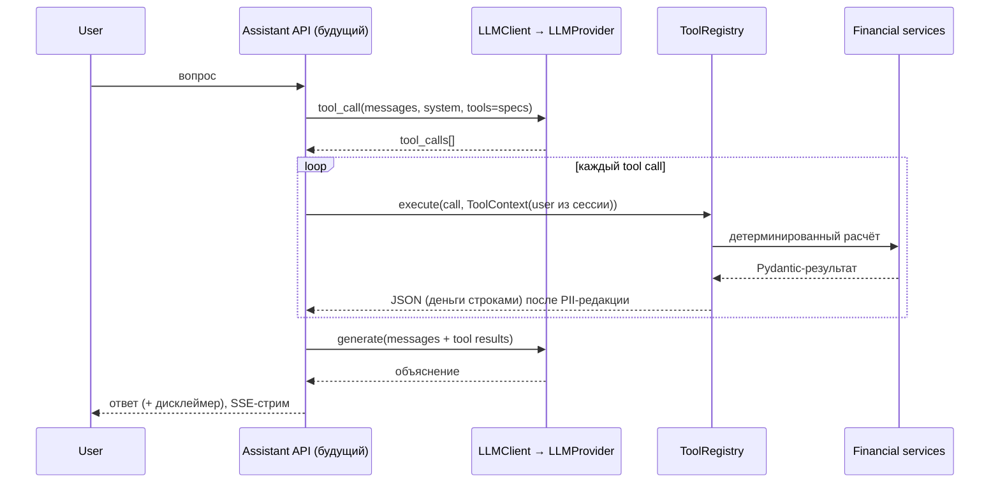

# AI Coach — проектный документ (не реализован)

Статус: реализованы только интерфейсы (`app/services/ai`). LLM, чат,
хранение диалогов и SSE — следующий этап.

## 1. Принцип

LLM **не является источником финансовой истины**. Он:

* понимает вопрос и задаёт уточняющие вопросы;
* выбирает инструменты (function calling);
* объясняет результат инструментов простым языком.

LLM **никогда не считает** проценты, ГЭСВ, платежи, переплату, срок,
доходность, долговую нагрузку, affordability и экономию — всё это
приходит из детерминированного слоя (`app/services/finance`,
`FinancialDecisionEngine`, `AffordabilityService`).

## 2. Поток запроса

## 3. Компоненты

| Файл | Назначение |
|------|------------|
| `contracts.py` | `Message`, `ToolSpec` (JSON Schema), `ToolCall`, `ToolResult`, `LLMResponse`, `StreamChunk`, `GenerationOptions` |
| `provider.py` | Протокол `LLMProvider`: `generate`, `stream`, `tool_call`; реестр `register_provider/get_provider`; `DisabledProvider` (503) |
| `llm.py` | `LLMClient` — фасад, провайдер выбирается `AI_PROVIDER` |
| `tools.py` | `ToolRegistry`, `ToolContext`, 11 инструментов |
| `privacy.py` | `PIIRedactor`, запрещённые ключи |
| `prompts/system_ru.md` | правила системного промпта (без цифр и ставок) |
| `advisor.py` | детерминированный адаптер над `FinancialDecisionEngine` |

### Провайдеры

`OpenAIProvider`, `AnthropicProvider`, `GeminiProvider` будут отдельными
модулями, реализующими `LLMProvider`, и регистрироваться в `PROVIDERS`.
Смена провайдера — одна настройка; tools, промпты и домен не меняются.
SDK провайдера импортируется только внутри его модуля.

## 4. Инструменты

| Tool | Сервис | Вход |
|------|--------|------|
| `get_financial_profile` | `FinancialProfileService` | — |
| `get_spending_breakdown` | `AnalyticsOverviewService` | `period` |
| `get_debts` | `DebtService.list` | — |
| `get_upcoming_payments` | `DebtService.calendar` | `days` |
| `simulate_debt_strategy` | `DebtService.strategy` | `extra_payment, strategy` |
| `calculate_loan` | `CalculatorService.loan` | `amount, annual_rate, term_months, schedule_type, fees` |
| `calculate_mortgage` | `CalculatorService.mortgage` | `price, down_payment, annual_rate, term_years` |
| `calculate_deposit` | `CalculatorService.deposit` | `amount, annual_rate, term_months, capitalization` |
| `calculate_affordability` | `AffordabilityService` | `new_payment` или `loan`, переопределения дохода/расходов |
| `calculate_emergency_fund` | `calculate_emergency_fund` | расходы, накопления, взнос |
| `search_bank_products` | `BankProductService.search` | `type, amount, term_months` |

Гарантии tool API:

* **Нет доступа к БД** у модели — только эти функции.
* **Пользователь задаётся сервером** (`ToolContext`), аргумент `user_id`
  отсутствует во всех схемах и игнорируется, если модель его передаст.
* Вход валидируется Pydantic; ошибки — структурированные коды
  (`INVALID_ARGUMENTS`, доменные коды, `TOOL_FAILED`) без stack trace.
* Выход детерминирован (одинаковый вход → одинаковый JSON).
* Ставки берутся только из `bank_products` с `source_url` и `fetched_at`;
  устаревшие помечены `is_stale`.

## 5. Приватность (PII minimization)

В LLM нельзя отправлять: ИИН, ФИО, PAN, CVV, номера счетов/IBAN,
телефоны, e-mail, credentials.

1. Инструменты возвращают агрегаты (`income`, `expenses`, `debt_payments`),
   а не сырые операции.
2. `PIIRedactor.sanitize` на выходе каждого инструмента:
   * удаляет ключи `email, full_name, iin, pan, cvv, account_number, iban,
     phone, password, token, user_id, …` на любой глубине;
   * маскирует ИИН, номера карт (13–19 цифр), IBAN KZ, телефоны, e-mail,
     имя пользователя, получателей переводов;
   * числовые значения не изменяются.
3. Системный промпт не содержит данных пользователя.
4. Будущие ограничения: лимит сообщений/токенов на пользователя
   (`GenerationOptions.user_id`), хранение данных граждан РК в РК,
   согласие (`users.consent_at`) обязательно до первого обращения к AI.

## 6. Правила ответа (prompts/system_ru.md)

* любое число — только из результата инструмента;
* риск и «потянет/не потянет» — только из `calculate_affordability`;
* для ставок — дата актуальности и ссылка на источник;
* не рекомендовать МФО и новые кредиты при высокой долговой нагрузке;
* дисклеймер: не индивидуальная финансовая рекомендация.

## 7. Что добавить при реализации

* `api/assistant.py`: `POST /assistant/chat` (SSE), `GET /assistant/conversations`,
  `GET /assistant/insights`.
* Таблицы `ai_conversations`, `ai_messages` (user_id, role, content,
  tool_calls, created_at) и `insights` — с тем же `OwnedRepository` и тестами изоляции.
* `AssistantService`: цикл tool calls с лимитом итераций, учёт токенов,
  логирование без содержимого сообщений.
* LLM-категоризатор как ещё один шаг `CategorizationPipeline`
  (батчи по 50, только merchant/описание после редакции).
* Оценочные тесты: ответы не содержат чисел, отсутствующих в tool results.
