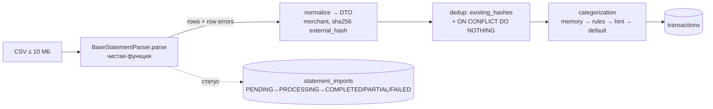
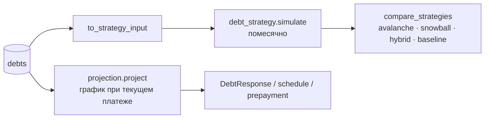

# Архитектура BudgetAnalytics (backend)

Модульный монолит на FastAPI. Главный принцип: **финансовые цифры
считает только детерминированный код**. Будущий AI Coach — верхний
интерфейсный слой, который вызывает инструменты и объясняет результат.

## 1. Слои

```mermaid
flowchart TB
    subgraph API["API layer (app/api)"]
        R[FastAPI routers<br/>Pydantic schemas · единый формат ошибок]
    end
    subgraph APP["Application services (app/services/*.py, debts/, imports/, analytics/)"]
        S[use-cases · проверки владения · commit]
    end
    subgraph DEC["Decision / Risk layer"]
        E[FinancialDecisionEngine<br/>AffordabilityService]
    end
    subgraph DOM["Financial domain (app/services/finance)"]
        F[money · loans · mortgages · deposits<br/>debt_strategy · emergency_fund · cashflow]
    end
    subgraph DATA["Financial data layer"]
        RP[Repositories (app/repositories)] --> DB[(PostgreSQL<br/>Alembic)]
    end
    AI[Future AI Coach<br/>app/services/ai] -. tools .-> S
    R --> S
    S --> E
    S --> F
    E --> F
    S --> RP
```

| Слой | Пакет | Правила |
|------|-------|---------|
| API | `app/api` | Только HTTP: валидация (Pydantic), вызов сервиса, ответная схема. Без SQL и бизнес-логики. |
| Application | `app/services/*` | Use-case: проверка владения, вызов домена, репозитории, **commit в конце**. Бросает `AppError` с кодом. |
| Decision | `app/services/decision`, `finance/affordability.py` | Детерминированные правила риска и рекомендаций, машинные коды находок. |
| Domain | `app/services/finance` | Чистые функции на `Decimal`, без БД/сети/LLM. Единственный источник цифр. |
| Data | `app/repositories`, `app/models` | Весь SQL. Только `flush`, фильтр `user_id` в каждом запросе к данным пользователя. |
| AI (интерфейсы) | `app/services/ai` | Контракты провайдеров, tool API, PII-редакция. LLM не подключён. |
| Tasks | `app/tasks` | Идемпотентные фоновые задачи (ARQ или cron). |

Зависимости направлены только вниз: домен не импортирует сервисы,
сервисы не импортируют API, AI-слой импортирует сервисы, но не наоборот.

## 2. Модули

| Модуль | API | Сервисы | Таблицы |
|--------|-----|---------|---------|
| Auth | `/auth/*` | `services/auth.py` | users, refresh_tokens |
| Профиль | `/auth/me/profile`, `/finance/profile` | `services/profile.py` | users |
| Карты | `/cards` | `services/cards.py` | cards |
| Импорт | `/upload/{bank}`, `/imports` | `services/imports`, `services/parser`, `services/categorization` | statement_imports, transactions |
| Транзакции и категории | `/transactions`, `/transactions/categories` | `services/transactions.py`, `categories.py` | transactions, categories |
| Бюджеты | `/budgets` | `services/budgets.py` | budgets |
| Вклады | `/investments` | `services/deposits.py` | deposits |
| Долги | `/debts` | `services/debts` | debts, debt_payments |
| Аналитика | `/analytics/overview`, `/analytics/*`, `/dashboard` | `services/analytics`, `dashboard.py` | — (агрегации) |
| Калькуляторы | `/finance/*` | `services/calculators.py` | — |
| Банковские продукты | `/products` | `services/products` | bank_products |
| Задачи | — | `app/tasks` | monthly_reports, payment_reminders |

## 3. Потоки данных

### Импорт выписки



* Хеш: `user | card:<id> или bank:<id> | дата | тип | сумма | нормализованное описание | номер повтора в файле`.
  Повторный импорт того же файла даёт те же хеши; честные одинаковые операции
  в одной выписке различаются номером повтора.
* `UNIQUE(user_id, external_hash)` — гарантия на уровне БД, в том числе при параллельных загрузках.
* Строки с ошибками не прерывают импорт (статус `partial`), сообщения об ошибках не содержат данных строки.
* Неизвестные категории из выписки создаются как **пользовательские**.

### Категоризация

`user memory → keyword rules → statement hint → (LLM fallback, позже) → «Без категории»`.
Память пользователя — последняя ручная правка категории для того же merchant
(`category_source = user`), поэтому она стоит первой: явная правка не должна
перебиваться общим словарём.

### Долги



Симуляция: проценты → минимальные платежи → остаток бюджета по стратегии →
закрытие → освободившийся платёж переходит на следующий долг. Расходящиеся
долги (платёж < процентов) определяются досрочно (`feasible=false`).

### Аналитика

`GET /analytics/overview` — ~10 агрегирующих запросов на ответ независимо от
объёма данных: `SUM/COUNT … GROUP BY`, `date_trunc(hour|day|week|month)`,
полуинтервал `[date_from, date_to)` по индексу `(user_id, transaction_date)`.
Пустые интервалы графика заполняются нулями. Тесты фиксируют, что число
запросов `/dashboard` и `/analytics/trend` не растёт с числом операций.

## 4. Финансовый слой (`app/services/finance`)

| Модуль | Что считает |
|--------|-------------|
| `money.py` | `Decimal`-only (float → `TypeError`), `ROUND_HALF_UP` до тиына, `Money` с валютой, явная конвертация, JSON-сериализация строкой `"1234.50"` |
| `calendar.py` | сдвиг месяцев с прижатием к концу месяца, даты платежей, високосные годы |
| `loans.py` | аннуитет, дифференцированный график, переплата, остаток, фиксированный платёж, досрочное погашение (`term`/`payment`), эффективная ставка (аналог ГЭСВ) |
| `mortgages.py` | ипотека + требуемый доход с учётом текущих платежей |
| `deposits.py` | простые проценты ACT/365 и ACT/ACT, помесячная капитализация, пополнения |
| `affordability.py` | долговая нагрузка, свободный поток, рекомендуемый максимум платежа, уровень риска, коды причин |
| `debt_strategy.py` | помесячная симуляция стратегий погашения |
| `emergency_fund.py` | целевой размер подушки и срок накопления |
| `cashflow.py` | норма сбережений, рост к прошлому периоду, средние |

Правила денег: хранение `Numeric(14,2)`, ставки `Numeric(7,4)`, округление
в конце каждого денежного события (проценты месяца, платёж), последний платёж
графика закрывает остаток ровно до нуля. Аналитика агрегирует операции в
`DEFAULT_CURRENCY` (KZT).

## 5. Repository layer и транзакции

* `OwnedRepository[T]`: `get_owned/list_owned/count_owned` всегда с `user_id`.
* Сессия на запрос (`get_db`), при исключении — rollback.
* Репозитории делают только `flush`; `commit` — в application-сервисе.
* Идемпотентные вставки — `INSERT … ON CONFLICT` (операции импорта, банки,
  продукты, отчёты, напоминания).

## 6. Безопасность

| Область | Решение |
|---------|---------|
| Изоляция | Каждый запрос к данным пользователя фильтруется по `user_id`; чужой ID → 404 (без раскрытия существования); ссылки в теле (категория, карта, операция) проверяются на владение. Тесты горизонтальной эскалации для всех ресурсов. |
| Пароли | bcrypt, 8+ символов, ≤ 72 байт, выравнивание времени при неизвестном email |
| Access-токен | PyJWT, 15 мин, обязательные `exp/iat/sub/jti/type`, `ver` = `users.token_version` |
| Refresh-токен | httpOnly + Secure + `SameSite=strict` cookie на `Path=/api/v1/auth`; одноразовый (ротация), повторное использование отзывает семью; `logout`, `logout-all`, смена пароля отзывают сессии |
| CSRF | Access-токен — в заголовке (CSRF неприменим). Cookie-эндпоинты: SameSite=strict + проверка `Origin` по `CORS_ORIGINS` |
| CORS | Явный список origin'ов из env, `*` запрещён валидатором |
| Карты | Только `last4` (CHECK в БД). PAN/CVV/срок/PIN не принимаются и не хранятся |
| Логи | request-id, без query/body; фильтр маскирует JWT, Bearer, пароли, PAN, ИИН, IBAN |
| Ошибки | `{"error": {"code", "message", "details"}}`; валидационные ошибки без исходных значений; 500 без внутренних деталей |
| Злоупотребления | rate limit на login/register/upload (in-memory), лимит файла 10 МБ |
| Удаление аккаунта | `DELETE /auth/me` + `ON DELETE CASCADE` на всех пользовательских таблицах |

## 7. Фоновые задачи

| Задача | Идемпотентность |
|--------|-----------------|
| `process_statement_import` | терминальный статус не обрабатывается повторно; дубли операций исключены unique-ключом |
| `generate_monthly_reports` | `UPSERT` по `(user_id, period_start)` |
| `send_payment_reminders` | `INSERT … ON CONFLICT DO NOTHING RETURNING` по `(debt_id, due_date, kind)` — уведомление только для новых строк |
| `update_bank_products` | `UPSERT` по `(bank, type, external_key)`, отсутствующие в выгрузке деактивируются, упавший источник ничего не меняет |

Запуск: `arq app.tasks.scheduler.WorkerSettings` (опционально, Redis) или
`python -m app.tasks.run <task>` из cron.

## 8. Будущий AI Coach

См. `docs/ai-architecture.md`. Кратко: `LLMProvider` (generate/stream/tool_call)
→ `ToolRegistry` (11 инструментов над сервисами этого документа) → PII-редакция.
Доменный слой не знает об AI.

## 9. Миграции

| Ревизия | Содержание |
|---------|------------|
| 0001 | исходная схема (6 таблиц) |
| 0002 | карты, журнал импорта, пользовательские категории, дедупликация, индексы, CASCADE, seed банков и системных категорий |
| 0003 | долги и платежи |
| 0004 | refresh-токены, token_version |
| 0005 | банковские продукты, ежемесячные отчёты, напоминания |

Тест `tests/integration/test_migrations.py` на отдельной БД выполняет
`upgrade head → downgrade base → upgrade head → alembic check`.
Downgrade 0002 lossy (пользовательские категории удаляются).

## 10. Изменения API (breaking) и совместимость

Сохранены все эндпоинты v0.1 и имена полей ответов. Несовместимые изменения:

1. **Формат ошибок**: `{"error": {"code", "message", "details"}}` вместо `{"detail": ...}` — требование единого контракта.
2. **Refresh-токен**: выдаётся и принимается через httpOnly-cookie; в теле ответа `refresh_token = null`.
   Для не-браузерных клиентов — `REFRESH_TOKEN_IN_BODY=true`.
3. **Смена пароля / logout-all** сразу отзывают выданные access-токены.
4. **Пароль**: минимум 8 символов, максимум 72 байта.
5. **Категории**: `POST /transactions/categories` создаёт категорию пользователя (не глобальную);
   тип категории должен совпадать с типом операции (`CATEGORY_KIND_MISMATCH`).
6. `TransactionResponse.category_id` может быть `null` (категория удалена); добавлены поля
   `currency, merchant, card_id, category_source, is_recurring`.
7. **Upload**: ответ дополнен `import_id, status, skipped_duplicates, failed, rows_total, errors`;
   файл > 10 МБ → 413.
8. Денежные значения в JSON всегда строки с 2 знаками.
9. `/analytics` → блок `investment` теперь содержит реальные суммы вкладов.
10. Бюджет с `category_id` считает `spent` по операциям месяца; ручной `spent` — только для бюджетов без категории.

## 11. Известные ограничения и риски

* Реальные выписки Kaspi/Halyk/Freedom — PDF; поддержан CSV-экспорт. Для PDF нужны образцы.
* Даты операций хранятся как локальное время без таймзоны; «сегодня» в аналитике — дата сервера
  (для РК сервер должен работать в Asia/Almaty либо нужно передавать TZ пользователя).
* Аналитика учитывает только `DEFAULT_CURRENCY`; валютные карты не конвертируются.
* Rate limiter хранит состояние в памяти процесса — для нескольких инстансов нужен Redis.
* Шифрование полей в БД (pgcrypto) не реализовано.
* Нет задачи очистки истёкших `refresh_tokens`.
* Для дифференцированных кредитов симуляция стратегий берёт текущий платёж как постоянный минимум.
* Эффективная ставка — приближение на месячных периодах (официальная формула НБРК — по дням).
* Асинхронный импорт требует файлового хранилища; сейчас импорт синхронный.
* Канал доставки напоминаний — заглушка (`LoggingNotifier`).
