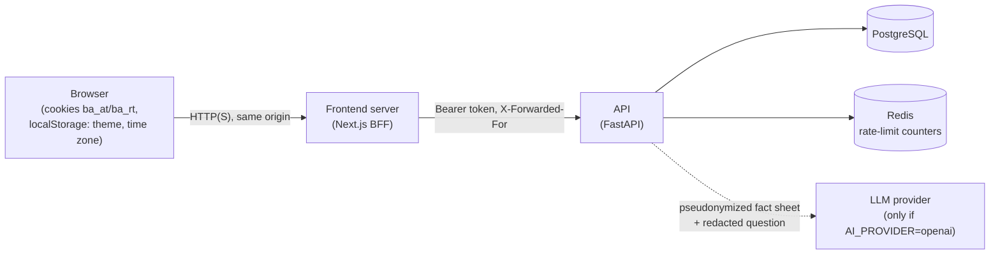

# Data Protection — Technical Record

What personal data BudgetAnalytics processes, where it flows and how it is protected. Every statement in sections 1–6 was verified in the code at commit `2bbaaef` (2026-11-20); file references are given so it can be re-checked. Section 7 lists **legal questions** that this document does not answer. Nothing here claims compliance with any law.

## 1. Personal data categories

| Category | Fields (database table) | Source | Notes |
|---|---|---|---|
| Identity and contact | `full_name`, `email` (`users`) | User at registration | E-mail is the login. No phone, address, date of birth or IIN fields exist. |
| Credentials | `hashed_password`, `token_version`, `is_active` (`users`) | User | Argon2 hash; the plain password is never stored. `token_version` invalidates sessions. |
| Sessions | `jti`, `family_id`, `expires_at`, `revoked_at`, `created_at` (`refresh_tokens`); browser cookies `ba_at` and `ba_rt` | System | One row per issued refresh token. **No automatic purge of expired rows was found.** |
| Preferences | `default_currency_code` (`users`); browser `localStorage`: time zone (`ba:timezone`) and theme (`theme`) | User | localStorage stays in the browser and is not sent to the server, except that the time zone is passed as a query parameter on analytics requests. |
| Financial accounts | `name`, `account_type`, `currency_code`, `bank_id`, `last4`, `opening_balance`, `opening_balance_at`, `is_archived` (`accounts`) | User | Only the **last 4 digits** of a card may be stored; a database constraint enforces exactly 4 digits. |
| Transactions | `amount`, `currency_code`, `description`, `merchant`, `transaction_type`, `transaction_date`, `category_id`, `account_id`, `bank_id`, `import_hash`, `import_id` (`transactions`) | User or statement import | Free-text `description` and `merchant` can reveal spending habits, health, religion and similar information. |
| Budgets, goals, deposits, categories | `budgets`, `financial_goals`, `deposits`, `categories` | User | Names are free text (goal and budget titles, custom category names). |
| Statement imports | `file_name`, `file_size`, `file_sha256`, `bank`, period, counters, status, `expires_at` (`statement_imports`); staged rows with `description`, `merchant`, `amount`, `transaction_date` (`statement_import_rows`) | Uploaded `.csv`/`.xlsx` | **The uploaded file itself is not stored**; it is parsed in memory. Card-like numbers in descriptions are masked. Staged rows of previews that are not committed are deleted after `IMPORT_PREVIEW_TTL_HOURS` (default 24 h); see §5. |
| AI usage metadata | `feature`, `provider`, `model`, `prompt_version`, `outcome`, `input_tokens`, `output_tokens`, `cost_usd`, `latency_ms`, `request_id` (`ai_usage`) | System | **Questions, prompts and answers are not stored** (`backend/app/services/ai/financial_advisor.py`). |
| Rate-limit counters | Redis keys `…:<rule>:<identifier>:<window>` | System | Per-IP rules use the **client IP address in plain form**; per-account login rules use a truncated SHA-256 of the e-mail (`backend/app/core/rate_limit.py`). Keys expire with their window (at most 1 hour). Redis runs without persistence in `compose.yaml`. |
| Logs | Method, path, status, duration and request id (`backend/app/core/middleware.py`) | System | No IP addresses, query strings, headers or bodies. Paths can contain record ids (for example `/api/v1/transactions/42`). |

**Not collected:** full card or account numbers, IIN, documents or IDs, location, contacts, device identifiers, advertising or analytics identifiers. No analytics, tracking or advertising scripts are included in the frontend.

## 2. Data flows

1. **Browser ↔ frontend.** All calls are same-origin. Tokens are kept in `httpOnly` cookies and never reach JavaScript.
2. **Frontend → API.** The frontend server forwards requests with the access token and the client IP (`X-Forwarded-For`, trusted only from the frontend's address in `compose.yaml`). It does not store data.
3. **API → PostgreSQL.** This is the only persistent store of user data.
4. **API → Redis.** Rate-limit counters only.
5. **API → LLM provider (optional, off by default).** Only when `AI_PROVIDER=openai`. The request goes to `OPENAI_BASE_URL` (default `https://api.openai.com/v1`) and contains:
   - a **fact sheet** of aggregated figures computed by the backend: totals, rates, budget and goal figures, deposits, period labels. System category names and bank names are sent as they are. User-entered names (custom categories, budget titles, goal names) are replaced by tokens such as `[CAT-1]` and restored only in the answer shown to the user. No user name, e-mail, internal ids, account names or numbers, or transaction descriptions are included (`backend/app/services/ai/facts.py`).
   - the **user's question**, after e-mails, card-like numbers, 12-digit numbers (IIN format) and Kazakhstan phone numbers are replaced (`backend/app/services/ai/prompts.py`). **Other personal information typed into the question, such as names, addresses or health details, is not removed.**

   With `AI_PROVIDER=none` (the default) no external call is made, and answers are rule-based.
6. **Build time only.** `next/font/google` downloads the Inter font while the frontend is being built. At runtime, browsers do not contact Google.

## 3. Storage locations

| Store | Where | Persistence |
|---|---|---|
| PostgreSQL | Docker volume `budgetanalytics_pgdata` in local setups; production per `docs/DEPLOYMENT.md` | Until deleted |
| Redis | Container memory | Lost on restart (no RDB/AOF) |
| Logs | Container stdout (Docker logging driver; the production compose limits files to 5 × 20 MB) | Per the operator's log setup |
| Backups | `backend/scripts/backup.sh` writes `pg_dump` archives, encrypted with `age` unless explicitly allowed otherwise | Per the operator's retention policy (not defined in the code) |
| Browser | Cookies (access token: token lifetime, 30 min by default; refresh token: 7 days by default); localStorage | Until expiry, logout or the user clears storage |

**The physical location (country) of the database depends on where the operator deploys it. The code does not determine it.**

## 4. Access controls

- **Authentication:** JWT access tokens (HS256 by default, 30 min), plus refresh tokens with rotation and reuse detection. Logout and logout-all are supported; changing the password revokes all sessions.
- **Tenant isolation:** every user-owned query is scoped to the authenticated user, and other users' records return `404`. This is covered by integration tests (`backend/tests/integration/test_tenant_isolation.py`).
- **Roles:** there is no admin role or admin interface in the application. Operators access data directly through the database.
- **Browser protections:**
  - same-origin BFF;
  - `SameSite=Strict` cookies (`Secure` in production);
  - CSRF header plus origin check;
  - Content-Security-Policy;
  - `X-Frame-Options: DENY`.
- **CORS:** `allow_credentials=False`; the origins come from `CORS_ORIGINS` (empty by default in `compose.yaml`).
- **Rate limits:** login, registration, token refresh, imports and AI requests.
- **Secrets:** environment variables in development, secret files in `backend/docker-compose.prod.yml`. Production settings refuse a weak `SECRET_KEY`.
- **Not provided by the application:** encryption at rest (it depends on the disk or managed database; listed as B5 in `docs/SECURITY_REVIEW.md`), audit logging of data access, and multi-factor authentication.

## 5. Retention and deletion

| Capability | Status |
|---|---|
| Delete individual transactions, budgets, goals, deposits, custom categories, imports | **Available** (API `DELETE` endpoints) |
| Delete an account (financial account) | Only if it has no transactions; otherwise it can only be archived |
| Expired import previews | Staged rows are deleted and the import is marked `expired`. This happens **when the same user next uses the import feature**, not on a schedule. |
| **Delete the user account and all its data** | **Not implemented.** There is no endpoint. In addition, most user-owned tables reference `users` without `ON DELETE CASCADE`, so deleting the user row requires deleting dependent rows first. Listed as blocker B2 in `docs/SECURITY_REVIEW.md`. |
| **Export of the user's data** | **Not implemented** |
| Expired refresh-token rows | **Not purged** automatically |
| Retention periods for accounts, transactions, logs and backups | **Not defined** |
| Scheduled jobs | None (`backend/app/tasks/` modules are empty) |

## 6. External services and processors

| Service | When | Data | Status |
|---|---|---|---|
| OpenAI or another OpenAI-compatible API | Only with `AI_PROVIDER=openai` and an API key | §2 item 5 | Off by default; never tested against a live provider in this repository |
| Hosting, managed database, object storage for backups | Depends on deployment | All stored data | Not defined in the repository |
| Google Fonts | Build time only | None about users | Not a runtime processor |

## 7. Questions for legal review (Kazakhstan and international)

These questions came out of the technical facts above. **They are not legal conclusions.** The applicable law, in particular the Law of the Republic of Kazakhstan "On Personal Data and Their Protection" and its amendments, could not be read from an official source while this document was being prepared. The official Adilet pages did not render for automated retrieval. A qualified Kazakhstan lawyer should answer each question.

| # | Topic | Technical fact | Question for counsel |
|---|---|---|---|
| Q-1 | Data localization | The database location is chosen by the operator | Must the personal data of Kazakhstan users be stored in a database located in Kazakhstan? Does this cover backups and logs? |
| Q-2 | Cross-border transfer | With `AI_PROVIDER=openai`, pseudonymized aggregates and the redacted question go to a provider that is likely abroad | Is this a cross-border transfer of personal data? Under what conditions is it allowed (consent, adequacy of the destination country, contract)? Is the pseudonymization sufficient to change the assessment? |
| Q-3 | Legal basis and consent | Registration collects name, e-mail and password; there is no consent checkbox or stored consent record | What consent form is required (written or electronic, separate per purpose)? Must consent be recorded and versioned? Does the AI feature need a separate, explicit opt-in? |
| Q-4 | Sensitive and financial data | Transaction descriptions can reveal sensitive information | Does financial transaction data fall under a special or "restricted access" category with extra requirements? |
| Q-5 | Data subject rights | No account deletion, no export, no automated deletion | Which rights (access, correction, deletion, withdrawal of consent) must be supported, within what deadlines, and in what form? Is manual operator handling acceptable at pilot scale? |
| Q-6 | Breach notification | No incident process in the repository | Are there obligations to notify an authority or users after a breach, and within what time? |
| Q-7 | Operator registration and roles | — | Does the operator need to notify or register with an authority? Who is the data controller (owner or operator) and who is a processor (hosting, LLM provider)? What contracts are needed? |
| Q-8 | Retention | No retention periods defined | What minimum or maximum retention applies to account and financial data, logs and backups? |
| Q-9 | Consumer protection (hosted service) | No payments or plans exist | If a paid hosted service is launched, which consumer-protection and e-commerce rules apply (terms, refunds, language of the terms)? |
| Q-10 | Financial-advice regulation | The advisor gives educational, rule-based or AI-generated explanations | Could any feature be treated as regulated financial, investment or credit advice? Are the disclaimers sufficient? |
| Q-11 | Other jurisdictions | Users outside Kazakhstan (for example in the EU) could register | Are other regimes (for example GDPR) triggered? Should registration be limited by country? |
| Q-12 | Language | The UI is Russian only | Must the policy and terms also be available in Kazakh? |

## 8. Open questions for the project owner

1. Who is the operator / data controller (legal name, country, contact)?
2. Where will production data, backups and logs be hosted (country and provider)?
3. Will the hosted service enable `AI_PROVIDER=openai`? If so, with which provider, which region, and under what data-processing terms (retention, use for training)?
4. What retention periods should apply, and when will account deletion and export be implemented (B2)?
5. Who handles privacy requests and security incidents, and through which channel?
